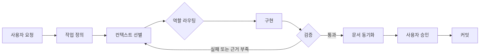

# Univ Group Management

> 학과, 동아리, 학회의 그룹 운영을 하나의 워크스페이스로 통합한 대학 조직 관리 플랫폼

[](https://flutter.dev)
[](https://spring.io/projects/spring-boot)
[](https://kotlinlang.org)
[](https://www.postgresql.org)

대학 조직의 공지, 채널, 권한, 일정, 장소 예약이 여러 도구에 흩어지는 문제를 해결하기 위해 만든 1인 풀스택 프로젝트입니다. 실제 대학 조직 구조를 그룹 계층으로 표현하고, 각 그룹에 독립적인 워크스페이스와 채널별 권한을 제공합니다.

이 저장소의 또 다른 결과물은 개발 과정에서 발전시킨 **파일 기반 AI 에이전트 하네스**입니다. 단순히 AI에게 구현을 요청하는 데서 그치지 않고, 필요한 맥락을 선별하고, 역할을 나누고, 검증과 사용자 승인을 거쳐 코드와 문서에 반영하도록 작업 방식을 반복해서 설계했습니다.

## 한눈에 보기

| 제품 | AI 네이티브 개발 실험 |
| --- | --- |
| 대학 조직을 반영한 6가지 그룹 유형 | 작업별 컨텍스트 패키지와 Bash 수집 자동화 |
| 그룹별 워크스페이스와 채널 | 프론트엔드, 백엔드, 권한, 테스트 역할 라우팅 |
| 그룹 역할과 채널 권한을 결합한 2계층 권한 모델 | 사전 검증, 체크리스트, 사용자 승인 기반 중단 조건 |
| 개인 캘린더와 그룹/장소 예약 백엔드 | 명세 기반 개발과 문서-커밋 동기화 |

<p align="center">
  
  <br />
  <sub>대학 조직과 소속 그룹을 탐색하는 화면</sub>
</p>

## 제품 기능

기능 설명은 사용자에게 제공하는 가치만 요약했습니다. 자세한 워크플로와 설계 근거는 [기능 상세 문서](docs/portfolio/features.md)에서 확인할 수 있습니다.

| 기능 | 해결한 문제 | 핵심 설계 | 상태 |
| --- | --- | --- | --- |
| 그룹 계층 | 공식 조직과 자율 모임을 하나의 모델로 표현 | 대학, 단과대, 학과, 연구실, 공식, 자율의 6가지 유형 | 핵심 기능 구현 |
| 워크스페이스와 채널 | 공지와 팀별 대화를 목적에 맞게 분리 | 그룹 생성 시 워크스페이스와 기본 채널 생성 | 구현 |
| 2계층 권한 | 같은 멤버도 채널마다 다른 권한이 필요 | 그룹 역할 + `ChannelRoleBinding`, 기본 차단 정책 | 구현 |
| 게시글과 댓글 | 채널 안에서 공지와 토론을 관리 | 게시글 고정, 댓글, 읽은 위치, Optimistic UI | 구현 |
| 통합 캘린더 | 개인 일정, 그룹 행사, 장소 예약의 분산 | 개인/그룹/장소 레이어와 예약 충돌 검사 | 개인 전체 구현, 그룹/장소 백엔드 구현 |
| 모집과 멤버 관리 | 공고, 지원, 승인 과정을 일원화 | 모집 상태와 가입 승인 흐름을 그룹 멤버십에 연결 | 백엔드 구현, 프론트엔드 진행 중 |

## 기술 구성

| 영역 | 기술 |
| --- | --- |
| Frontend | Flutter 3.35, Dart 3.9, Riverpod, GoRouter, Dio |
| Backend | Spring Boot 3.5, Kotlin 1.9, JPA/Hibernate |
| Auth | Google OAuth 2.0, JWT |
| Data | H2 개발 환경, PostgreSQL 운영 대상 |
| Performance | Caffeine Cache, Fetch Join |
| Verification | JUnit 5, Flutter Test, 문서 링크 검사 스크립트 |

전체 애플리케이션 구조와 기술 선택의 이유는 [아키텍처 문서](docs/portfolio/architecture.md)와 [기술 결정 문서](docs/portfolio/decisions.md)에 정리했습니다.

## 실행 방법

### 사전 요구사항

- Flutter SDK 3.35+ / Dart SDK 3.9+
- Java 17+
- Google OAuth 2.0 Client ID

### 로컬 실행

첫 번째 터미널에서 저장소를 복제하고 백엔드를 실행합니다.

```bash
git clone https://github.com/SungKong00/univ_group_management.git
cd univ_group_management/backend
./gradlew bootRun
```

두 번째 터미널에서는 복제한 저장소의 절대 경로를 기준으로 프론트엔드를 실행합니다.

```bash
cd /path/to/univ_group_management/frontend
cp .env.example .env
# .env에 사용할 Google OAuth Client ID를 설정
flutter pub get
flutter run -d chrome --web-hostname localhost --web-port 5173
```

---

## AI 에이전트 하네스

여기서 **하네스**는 특정 AI 모델을 뜻하지 않습니다. AI가 프로젝트 안에서 일할 때 따라야 하는 입력 구조, 역할, 도구, 검증 조건, 승인 절차를 묶은 작업 환경을 뜻합니다.

처음에는 Claude, Gemini, Codex 사이에 파일을 전달하는 수동 협업 구조였습니다. 이후 컨텍스트가 커지고 문서가 오래되는 문제를 겪으면서, 컨텍스트 선별, 역할 라우팅, 검증 루프, 문서 동기화, 명세 기반 실행으로 구조를 바꿨습니다.

### 실험을 거쳐 문서화한 작업 구조



이 흐름의 핵심은 AI의 답을 바로 확정하지 않는 것입니다.

- **작업 정의:** 무엇을 바꾸고 무엇을 바꾸지 않을지 먼저 고정합니다.
- **컨텍스트 선별:** 저장소 전체가 아니라 현재 작업에 필요한 문서와 코드만 전달합니다.
- **역할 라우팅:** 프론트엔드, 백엔드, 권한, 테스트처럼 서로 다른 기준을 별도 역할 가이드로 분리합니다.
- **검증 루프:** 테스트, 문서 간 모순, 체크리스트를 확인하고 조건을 만족하지 못하면 다시 분석합니다.
- **사람의 통제:** 불확실하거나 체크리스트가 끝나지 않은 상태에서는 사용자의 결정을 기다립니다.
- **지식 동기화:** 코드 변경과 함께 다음 작업에서 사용할 문서 컨텍스트도 갱신합니다.

### 하네스 진화 타임라인

| 시기 | 발견한 문제 | 구조 변화 | 얻은 원리 | 근거 |
| --- | --- | --- | --- | --- |
| 2025-09-10 | 모델을 바꾸면 작업 목적과 프로젝트 맥락이 끊김 | `TASK.MD`, 입력 컨텍스트, 출처 목록, 합성 결과를 하나의 작업 패키지로 구성 | 대화보다 파일을 인수인계 계약으로 사용 | [`f46c35a`](https://github.com/SungKong00/univ_group_management/commit/f46c35a5a50d31e00c663c931585a22941919ba3) |
| 2025-09-10 | 컨텍스트를 매번 수동으로 모으기 어려움 | Bash `bin/gemini`가 Markdown을 탐색하고 합성 입력을 생성 | 컨텍스트의 저장과 선택을 스크립트로 재현 | [`bin/gemini`](https://github.com/SungKong00/univ_group_management/blob/f46c35a5a50d31e00c663c931585a22941919ba3/bin/gemini) |
| 2025-09-27 | 컨텍스트와 작업 폴더가 누적되어 오히려 탐색이 어려워짐 | 누적 폴더와 스크립트를 제거하고 7개 역할 가이드로 전환 | 많이 넣는 것보다 책임과 맥락을 분리 | [`6c3e671`](https://github.com/SungKong00/univ_group_management/commit/6c3e671b82c4516a6cad1b97273d26fec4f577fe) |
| 2025-09-29 ~ 10-06 | 역할 문서가 있어도 어떤 역할을 선택할지 일관되지 않음 | 역할 디렉터리 정리, 컨텍스트 동기화 역할, 작업 분류 명령, 저장소 지침 추가 | 요청을 먼저 분류하고 해당 가이드로 라우팅 | [`20b7e29`](https://github.com/SungKong00/univ_group_management/commit/20b7e29f5e46fcd8d79c6207c90bb77c763d5f57), [`77c6071`](https://github.com/SungKong00/univ_group_management/commit/77c6071cdcdd16708997ff20b5a0985ccd6c63b2), [`6c6b8a6`](https://github.com/SungKong00/univ_group_management/commit/6c6b8a6a4aaad7bf422dfa0024d0e80763cbf28f) |
| 2025-10-24 | AI가 요청을 잘못 이해한 채 바로 구현하는 위험 | `요청 → 파악 → 검증 → 승인 → 실행` 사전 프로토콜 도입 | 불확실성을 프롬프트가 아니라 작업 중단 조건으로 관리 | [`84a7100`](https://github.com/SungKong00/univ_group_management/commit/84a71005c555c297726363492105cd538ac915ac) |
| 2025-11-09 ~ 11-10 | 요구사항, 계획, 구현 결과가 서로 어긋날 수 있음 | Spec Kit 분석/체크리스트/실행 게이트, 도구 선택 정책, worktree 설정 복구 자동화 추가 | 명세와 검증을 실행 전후의 제어면으로 사용 | [`0263cd4`](https://github.com/SungKong00/univ_group_management/commit/0263cd4294840617067faecf9ebdb2e0426c4b28), [`62bc389`](https://github.com/SungKong00/univ_group_management/commit/62bc38955f90dfb8d40e27fcebcd832a606cf39e), [`ff84ff3`](https://github.com/SungKong00/univ_group_management/commit/ff84ff3c3085c9b76e88cc381220af6a2657253a) |

<details>
<summary><strong>단계별 구조와 시행착오 자세히 보기</strong></summary>

#### 1. 대화 대신 작업 패키지로 컨텍스트 전달

초기 구조는 모델마다 잘하는 일을 나누는 수동 파이프라인이었습니다.

```text
tasks/2025-09-10-context/
├── TASK.MD
├── synthesis_input/
│   ├── INPUT_CONTEXT.md
│   ├── CONTEXT_SOURCES.md
│   └── PROMPT.md
└── SYNTHESIZED_CONTEXT.MD
```

Gemini가 프로젝트 문서를 합성하고, Claude가 구현하며, Codex가 디버깅을 지원하도록 역할을 정했습니다. 중요한 점은 모델 사이의 대화 기록에 의존하지 않고 `TASK.MD`와 `SYNTHESIZED_CONTEXT.MD`를 다음 작업자가 읽을 수 있는 인수인계 문서로 만든 것입니다.

컨텍스트 탐색 자동화는 Python이 아니라 **Bash**로 구현했습니다. 당시의 [`bin/gemini`](https://github.com/SungKong00/univ_group_management/blob/f46c35a5a50d31e00c663c931585a22941919ba3/bin/gemini)는 `find`로 Markdown 파일을 수집하고, 출처 목록과 합성 입력을 생성했습니다. Python 기반 컨텍스트 갱신 도구는 문서에 계획으로 등장했지만 커밋된 구현 기록은 없습니다.

#### 2. 컨텍스트 축적에서 컨텍스트 위생으로 전환

파일을 계속 쌓으면 맥락이 보존될 것이라고 예상했지만, 오래된 작업 파일과 중복 문서가 늘면서 무엇을 신뢰해야 하는지가 불명확해졌습니다. 이에 누적 `tasks/**`, `context/**`, `bin/gemini`를 제거하고, 필요한 책임만 역할 문서로 분리했습니다.

이 전환을 통해 컨텍스트 관리는 “모든 정보를 저장하는 일”이 아니라 “현재 작업에 필요한 정보만 찾고, 오래된 정보를 갱신하거나 제거하는 일”이라는 기준을 세웠습니다.

#### 3. 역할 이름을 실행 규칙으로 발전

`frontend-specialist`, `backend-architect`, `permission-engineer`, `test-automation`, `context-manager`처럼 역할별 책임과 참고 문서를 정의했습니다. 이후 요청을 분류해 해당 역할과 문서로 연결하는 명령을 추가하고, 저장소 수준 지침인 [`AGENTS.md`](AGENTS.md)에도 같은 원칙을 반영했습니다.

역할 분리는 여러 모델을 무조건 동시에 실행하기 위한 것이 아니라, 하나의 에이전트라도 작업 성격에 맞는 판단 기준과 컨텍스트를 사용하게 만드는 라우팅 장치였습니다.

#### 4. 환각 방지를 검증과 승인 조건으로 표현

[`pre-task-protocol.md`](docs/agents/pre-task-protocol.md)는 구현 전에 관련 문서를 찾고, 요청 해석과 영향 범위를 사용자에게 설명하고, 승인을 받은 뒤 실행하도록 정의했습니다. 요구사항이 모호하거나 문서가 충돌하면 구현을 계속하지 않는 것이 핵심입니다.

이후 Spec Kit의 [`analyze`](.claude/commands/speckit.analyze.md), [`checklist`](.claude/commands/speckit.checklist.md), [`implement`](.claude/commands/speckit.implement.md) 단계를 도입했습니다. 체크리스트가 끝나지 않았을 때 자동으로 통과시키지 않고 사용자의 결정을 기다리도록 하여, 검증 결과를 실제 중단 조건으로 연결했습니다.

#### 5. 코드와 작업 지식을 함께 유지

[`context-sync-agent`](docs/agents/context-sync-agent.md)와 [`commit-management-agent`](docs/agents/commit-management-agent.md)는 커밋 전에 코드 변경이 문서에 반영되었는지 확인하는 의도된 절차를 정의했습니다. 모든 커밋에서 실행되었다는 보장은 아니며, 작업 방식의 설계 기록입니다. 또한 [도구 선택 정책](.specify/memory/constitution.md)과 [post-checkout hook](.githooks/post-checkout)을 추가해, 작업 종류에 맞는 도구를 선택하고 worktree에서도 로컬 설정을 복구하도록 했습니다.

이 단계에서 문서는 설명 자료를 넘어, 다음 에이전트의 입력과 실행 순서를 제어하는 프로젝트의 제어면 역할을 하게 되었습니다.

</details>

### 현재의 방법론으로 다시 읽기

이 기록은 아래 개념을 처음 발명했다는 주장이 아닙니다. 공개된 패턴을 실제 프로젝트의 파일, 스크립트, 역할 문서, 검증 게이트로 구체화하고 실패에 따라 구조를 바꾼 과정에 의미가 있습니다.

| 저장소에서 한 시도 | 현재 널리 쓰이는 설명 | 시점과 해석 |
| --- | --- | --- |
| 작업 컨텍스트를 파일로 저장하고 필요한 것만 선택 | [Context Engineering](https://www.langchain.com/blog/context-engineering-for-agents)의 write/select/compress/isolate | 관련 글 공개 2025-07-02, 저장소 적용 2025-09-10. 약 2개월 뒤 프로젝트 워크플로로 구체화 |
| 요청을 역할별 가이드로 분류 | [Routing과 Orchestrator-workers](https://www.anthropic.com/engineering/building-effective-agents) | 공개 패턴을 프레임워크보다 단순한 Markdown 기반 라우팅으로 적용 |
| 분석, 체크리스트, 승인 후 실행 | [Human-in-the-loop](https://openai.github.io/openai-agents-python/human_in_the_loop/)와 evaluator gate | 사람의 확인을 권고 문구가 아니라 실행 중단 조건으로 표현 |
| 명세, 계획, 작업 목록, 구현의 연결 | [Spec Kit](https://github.com/github/spec-kit)의 Spec-Driven Development | 2025-11 저장소에 명령과 검증 단계를 직접 도입 |
| 작업 종류에 맞는 외부 도구 선택 | [Model Context Protocol](https://modelcontextprotocol.io/docs/getting-started/intro)의 도구 연결 관점 | 완전한 MCP 플랫폼을 만든 것이 아니라 프로젝트 수준 도구 선택 정책으로 적용 |

### 검증 가능한 범위

- Git 이력으로 파일의 추가, 이동, 삭제와 시점을 확인할 수 있습니다.
- 역할 문서와 스크립트는 **작업 방식의 설계 증거**입니다.
- 모든 과거 작업의 실행 로그가 남아 있지는 않으므로, 완전 자율 멀티 에이전트 시스템이나 정량적으로 성능이 입증된 하네스라고 주장하지 않습니다.
- 하네스의 핵심 성과는 특정 모델보다 **컨텍스트, 역할, 검증, 승인 구조를 반복 가능하게 만든 것**입니다.

## 저장소 구조와 상태

```text
univ_group_management/
├── frontend/          # Flutter Web 애플리케이션
├── backend/           # Spring Boot 애플리케이션
├── frontend_new/      # 디자인 시스템과 컴포넌트 실험
├── backend_new/       # 도메인 분리와 Clean Architecture 실험
├── docs/              # 개념, 구현, UI/UX, 회고 문서
├── .claude/           # 역할 가이드와 작업 명령
├── .specify/          # 명세 기반 워크플로와 검증 스크립트
├── AGENTS.md          # 저장소 수준 에이전트 작업 원칙
├── CLAUDE.md          # Claude 작업 컨텍스트
└── GEMINI.md          # Gemini 문서/커밋 워크플로
```

`frontend/`와 `backend/`가 동작하는 애플리케이션 코드입니다. `frontend_new/`와 `backend_new/`는 각각 디자인 시스템과 Clean Architecture를 별도로 검증한 실험 디렉터리이며, 현재 운영 코드에 모두 통합된 상태를 의미하지 않습니다.

## 상세 문서

| 문서 | 내용 |
| --- | --- |
| [기능 상세](docs/portfolio/features.md) | 기능별 문제, 사용자 흐름, 구현 상태 |
| [아키텍처](docs/portfolio/architecture.md) | 시스템 구조와 주요 설계 결정 |
| [기술적 도전](docs/portfolio/technical-challenges.md) | 권한 성능, 상태 관리, UI 등 문제 해결 과정 |
| [기술 선택과 회고](docs/portfolio/decisions.md) | 대안 비교와 선택 근거 |
| [프로젝트 변천사](docs/portfolio/development-journey.md) | 제품과 코드 구조의 전체 발전 과정 |
| [컨텍스트 동기화 상태](docs/context-tracking/sync-status.md) | 문서와 구현의 동기화 기록 |

## 프로젝트 정보

- 핵심 기능 개발: 2025년 9월 ~ 12월
- 저장소 정리와 포트폴리오 문서화: 2026년 3월 이후
- 개발 인원: 1명
- 담당 범위: 기획, 설계, Flutter, Spring Boot, 테스트, 문서화, AI 에이전트 워크플로 실험
